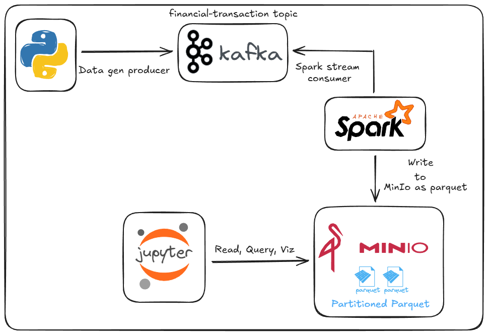

# Kafka → Spark → MinIO transactions pipeline

A small real-time data pipeline. A Python producer publishes synthetic financial transactions to Kafka, Spark Structured Streaming cleans and enriches them, and the result is stored in MinIO (S3-compatible) as Parquet partitioned by day. A notebook reads the data back for analysis.



## Stack

- Apache Kafka (Redpanda broker, Conduktor Console to inspect topics)
- Apache Spark 3.5 Structured Streaming (PySpark)
- MinIO as an S3-compatible data lake
- Parquet (Snappy), partitioned by `date_only`
- Jupyter notebook with PySpark and matplotlib

## Repository layout

| Path | Purpose |
|---|---|
| `producer.py` | Generates a random transaction every 2 seconds and publishes it to the `financial-transactions` topic |
| `consumer.py` | Prints messages from the topic, useful to check the producer |
| `spark_streaming.py` | Streaming job: Kafka → clean and enrich → Parquet on MinIO |
| `analysis.ipynb` | Reads the Parquet data back, runs aggregations and plots a chart |
| `Conduktor/docker-compose.yml` | Redpanda broker and Conduktor Console |
| `Minio/docker-compose.yml` | MinIO, plus a one-shot container that creates the `warehouse` bucket |

## Data model

Each Kafka message is a JSON transaction. Field names are in French.

```json
{
  "id_transaction": "618497d0-1fda-412e-aa8f-4d85f8ab0c0f",
  "type_transaction": "remboursement",
  "montant": 669.34,
  "devise": "USD",
  "date": "2025-12-27T04:25:54.170133",
  "lieu": "Rue de Paris, Toulouse",
  "moyen_paiement": "virement_bancaire",
  "details": { "produit": "Produit16", "quantite": 8, "prix_unitaire": 49.58 },
  "utilisateur": {
    "id_utilisateur": "User597",
    "nom": "Utilisateur579",
    "adresse": "363 Rue Gustave Courbet, Toulouse",
    "email": "utilisateur621@example.com"
  }
}
```

`type_transaction` is one of `achat`, `remboursement`, `transfert`. `moyen_paiement` is one of `carte_de_credit`, `especes`, `virement_bancaire`, `erreur`.

## What the Spark job does

- Parses the JSON messages with an explicit schema.
- Adds `montant_eur` (USD converted at a fixed 0.85 rate), `timezone` (`Europe/Paris`), `date_ts` (timestamp) and `date_only` (day, used as the partition column).
- Drops records whose `moyen_paiement` is `erreur` or whose `lieu` is null. The producer emits a few of these on purpose to exercise the cleaning step.
- Appends the result to `s3a://warehouse/transactions` as Parquet partitioned by `date_only`, with checkpoints in `s3a://warehouse/checkpoints/transactions`.

## Running it

Requirements: Docker with Compose, Java 8, 11 or 17 (for Spark), and Python 3.10+.

```bash
pip install -r requirements.txt
```

**1. Start Kafka.**

```bash
docker compose -f Conduktor/docker-compose.yml up -d
```

Conduktor Console is on http://localhost:8080 and the broker is reachable from the host at `localhost:19092`. The `financial-transactions` topic is created on first write; if it isn't, create it from the Console.

**2. Start MinIO.**

```bash
docker compose -f Minio/docker-compose.yml up -d
```

The S3 API is on `localhost:9000` and the web console on http://localhost:9001 (user `minio`, password `minio123`). The `warehouse` bucket is created automatically.

**3. Start the producer.**

```bash
python producer.py
```

**4. Start the streaming job.**

```bash
python spark_streaming.py
```

The first run downloads the Kafka and S3A connectors from Maven Central, so it needs internet access. Leave the job running; it writes a Parquet file to MinIO for each micro-batch.

**5. Analyse the data.** Open `analysis.ipynb` in Jupyter or VS Code and run all cells.

To stop everything, press Ctrl+C in the producer and streaming terminals, then run `docker compose -f <file> down` for each compose file.

### Notes

- **Windows:** Spark needs `winutils.exe` and `hadoop.dll` in `%HADOOP_HOME%\bin`. The scripts and notebook default `HADOOP_HOME` to `C:\hadoop` when it isn't set.
- **Local only:** the MinIO credentials are the development defaults from the compose file, and all services run on a single machine.
- MinIO stores its data in `Minio/minio/`, which is git-ignored.
- `Conduktor/docker-compose.yml` is based on Conduktor's getting-started file and also starts its sample data generator.
